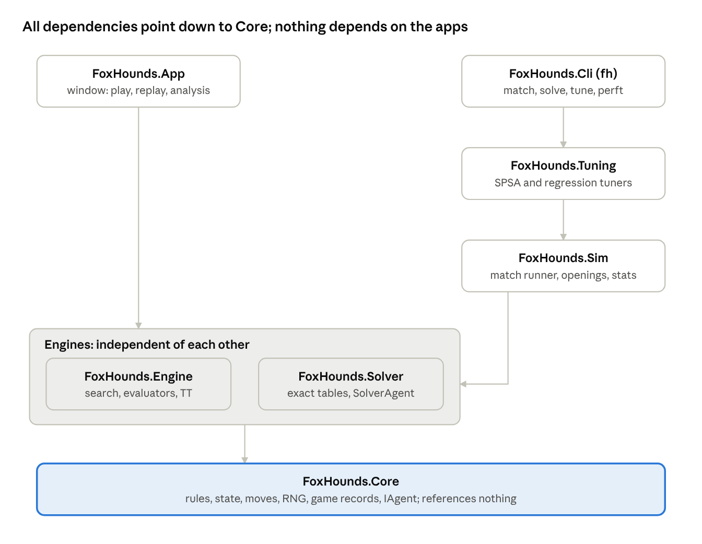
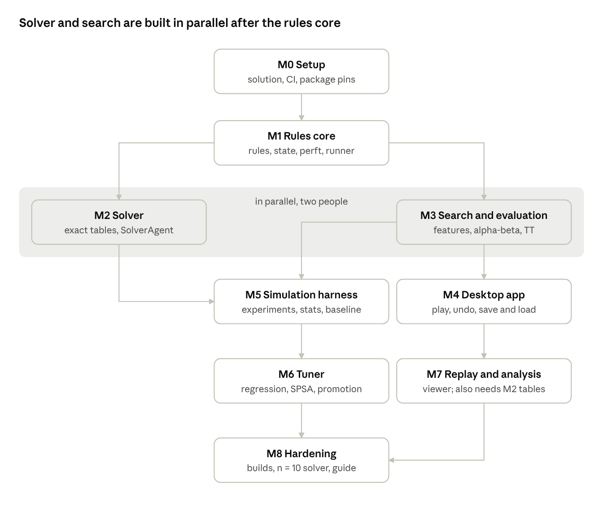

# Fox and Hounds — Implementation Specification

Nov 5, 2026 · @Panos · Status: Draft v1.0

## 1. Purpose and scope

We are building a desktop Fox and Hounds game in C# on an n×n board (default 8), where either side can be a human or an AI, plus the tooling to prove the AI is competent and to tune it with data instead of guesswork.

**Deliverables**

1.  **Core rules library**: board sizes n = 4…16, n/2 hounds (rounded down), one fox. Headless, deterministic, allocation-free on the hot path.

2.  **Desktop app** with basic 2D graphics: choose Human or AI for each side, play, undo, save and load games, and a replay/analysis viewer.

3.  **Minimax AI**: alpha-beta search with iterative deepening, a transposition table and pluggable weighted evaluation functions.

4.  **Exact solver** for small boards (n ≤ 8 required, n = 10 stretch). It is the ground truth used to grade evaluation functions and catch blunders.

5.  **Simulation harness**: thousands of reproducible AI-vs-AI games in parallel, with statistics and confidence intervals.

6.  **Automatic weight tuner**: searches evaluation weights using match results and solver labels.

7.  **CLI** exposing 3–6 without the UI.

**Non-goals for v1**: network play, mobile, sound, animation beyond a simple move highlight, Monte Carlo Tree Search, neural networks. The architecture must not block adding MCTS later (it is just another agent).

**How to read this spec**

- MUST / SHOULD / MAY carry their RFC 2119 meaning. MUST items are acceptance criteria; tests are derived from them.

- Sections 3, 5 and 6 are normative: if code and spec disagree, the code is wrong.

- Anything this spec does not cover: do not guess. Raise it with the tech lead; it goes into Section 17 before it goes into code.

- "Competent" is defined by measurable targets in Sections 8.9 and 16, scored against the exact solver.

## 2. Glossary and conventions

Every coordinate, count and score in code, logs and files follows this table. Mixing conventions is the most likely source of silent bugs in this project.

| Term             | Definition                                                                                                            |
|------------------|-----------------------------------------------------------------------------------------------------------------------|
| n                | Board side length. 4 ≤ n ≤ 16. Default 8.                                                                             |
| H                | Number of hounds = ⌊n/2⌋.                                                                                             |
| Row r, column c  | 0-based. Row 0 is the **top** of the screen and the hounds' home row. Column 0 is the left edge.                      |
| Playable square  | A square with (r + c) odd (the "dark" squares). All other squares are never occupied.                                 |
| P                | Number of playable squares = ⌊n²/2⌋ (32 for n = 8).                                                                   |
| Square index     | Integer 0…P−1 identifying a playable square: index = (r·n + c) \>\> 1. Defined in 5.1.                                |
| Algebraic name   | File letter a + c, rank number n − r. So (7,4) = e1, (0,1) = b8. Used in UI, logs and files only.                     |
| Forward          | Hounds: increasing row (down the screen). Fox: decreasing row (up the screen).                                        |
| Ply              | One turn by one side. **All counts in this project are plies.** The word "move" means one ply.                        |
| Side to move     | Side.Fox or Side.Hounds. Part of the position.                                                                        |
| Position         | Fox square + set of hound squares + side to move. Hounds are interchangeable: only the set matters.                   |
| minHoundRow      | The smallest row occupied by any hound (the rearmost hound).                                                          |
| Score (internal) | Negamax convention: positive = good for the **side to move**.                                                         |
| Score (external) | UI, logs and files always report scoreFox: positive = good for the Fox. The field name must carry the perspective.    |
| WIN              | Constant 1,000,000. "Side to move wins in d plies" scores WIN − d; "loses in d plies" scores −(WIN − d).              |
| EVAL_MAX         | Constant 100,000. Every heuristic evaluation is clamped to ±EVAL_MAX so it can never be mistaken for a proven result. |
| Agent            | Anything that picks moves for one side: human, random, minimax, solver.                                               |
| Ruleset          | The immutable configuration of rule variants (3.6). Two games are only comparable if their rulesets are equal.        |

## 3. Game rules (normative)

The default ruleset, **Classic**, follows the common published rules: hounds on b8, d8, f8, h8, fox on e1, fox moves first, the fox wins by reaching the hounds' home row and the hounds win by trapping the fox ([Wikipedia: Fox games](https://en.wikipedia.org/wiki/Fox_games), [Board Game Matcher](https://boardgamematcher.com/game/fox-and-hounds)). Everything that varies between published versions is a ruleset field (3.6), never a code fork.

### 3.1 Board

- n×n squares; only playable squares (r + c odd) are ever occupied.

- n outside 4…16 MUST be rejected when the ruleset is constructed (ArgumentOutOfRangeException).

### 3.2 Initial position

- **Hounds**: one hound on every playable square of row 0. That gives exactly H = ⌊n/2⌋ hounds for even and odd n.

- **Fox**, per FoxStart:

  - Fixed (default): the playable square of row n−1 with the largest column ≤ ⌊n/2⌋. For n = 8 this is e1. FixedFoxColumn may override it; a column that is not playable in row n−1 is a configuration error.

  - ChooseOnBackRow: before the first ply, the fox's agent picks any playable square of row n−1. The choice is not a ply and is stored in the game record header.

- **Side to move**: FirstMover (default Fox).

### 3.3 Legal plies

- **Fox**: move the fox one step diagonally, in any of up to 4 directions, to an empty playable square.

- **Hounds**: pick exactly one hound and move it one step diagonally forward (row + 1) to an empty playable square.

- No jumps, captures, promotion or passing. A side with at least one legal ply must play one.

### 3.4 End of game

Evaluate the position after setup and after every ply, in this exact order. The first rule that matches decides.

1.  FoxWinCondition = ReachHomeRow and the fox is on row 0 → Fox wins, reason FoxReachedHome.

2.  Fox to move with no legal ply → Hounds win, reason FoxTrapped.

3.  Hounds to move with no legal ply → Fox wins, reason HoundsImmobile. This applies under both win conditions (decision D-03).

4.  AdjudicateEscape = true and the test in 3.5 passes → Fox wins, reason FoxEscaped.

5.  Otherwise the game continues.

Outside the rules, the game controller ends a game with reason Forfeit when an agent throws, returns an illegal ply or exceeds a hard time limit. The offending side loses.

### 3.5 Escape adjudication (optional)

The fox has escaped once no hound can ever block it again. Declaring the win at that moment shortens games and searches without changing any result.

- Under ReachHomeRow: escaped when **fox.row ≤ minHoundRow**. Rows above minHoundRow stay hound-free forever, so the fox always has an empty square one row up and walks home.

- Under HoundsImmobile: escaped when **fox.row \< minHoundRow and minHoundRow ≥ 2**. The fox then owns at least two connected hound-free squares to shuttle between until the hounds run out of plies.

Adjudication shortens games, so it changes "win in d plies" distances. The solver MUST run with it off. Tests that compare distances MUST turn it off; tests that compare only win/loss MAY leave it on. Its soundness MUST be proven against the solver (test T-SOL-04, Section 15).

### 3.6 Ruleset fields

RuleSet is an immutable C# record with value equality. Every game record, experiment and solver table stores the ruleset it used.

| Field            | Type | Default            | Allowed values               |
|------------------|------|--------------------|------------------------------|
| BoardSize        | int  | 8                  | 4…16                         |
| FoxStart         | enum | Fixed              | Fixed, ChooseOnBackRow       |
| FixedFoxColumn   | int? | null (rule in 3.2) | a playable column of row n−1 |
| FirstMover       | Side | Fox                | Fox, Hounds                  |
| FoxWinCondition  | enum | ReachHomeRow       | ReachHomeRow, HoundsImmobile |
| AdjudicateEscape | bool | true               | true, false                  |

Presets: RuleSet.Classic = all defaults. RuleSet.Gilith = HoundsImmobile with adjudication off; it exists only to cross-check our solver against the published solve at [gilith.com](https://gilith.com/foxhounds/design.html).

### 3.7 Properties the code may rely on, and must assert

- **No draws.** Every game ends with a winner.

- **Bounded length.** Each hound ply raises the sum of hound rows by exactly 1, and that sum is capped at H·(n−1). A game therefore lasts at most 2·H·(n−1) + 1 plies: 57 for n = 8. The controller MUST throw if a game exceeds this; it means a rules bug.

- **Acyclic.** No position can repeat, so search needs no repetition detection and the solver can sweep positions in order (Section 10).

- **No mirror symmetry for even n.** Reflecting columns maps playable squares onto unplayable ones. Do not add symmetry reduction for even n. For odd n, c → n−1−c is a true symmetry.

- **Balance depends on n.** Published results: hounds win with perfect play on 8×8, even if the fox chooses its starting square ([Wikipedia](https://en.wikipedia.org/wiki/Fox_games), citing *Winning Ways*). The gilith solve, under HoundsImmobile, finds hounds wins on 4×4, 8×8 and 10×10 but a **fox** win on 6×6. No test may assume a winner for a board size unless the solver has established it.

## 4. Tech stack and solution layout

Target **.NET 10 (LTS, supported to November 2028)**, not .NET 8: .NET 8 and 9 reach end of support on 10 November 2026 ([.NET Blog](https://devblogs.microsoft.com/dotnet/dotnet-8-9-end-of-support/)). The game logic is a headless library; the window, the CLI and the experiment tools are thin shells around it.

### 4.1 Stack

| Concern            | Choice                                                                                | Notes                                                                  |
|--------------------|---------------------------------------------------------------------------------------|------------------------------------------------------------------------|
| Runtime / language | .NET 10, default C# version for net10.0                                               | TargetFramework set once in Directory.Build.props                      |
| Graphics           | [Raylib-cs](https://packages.nuget.org/packages/Raylib-cs/) 8.1.x                     | zlib licence, binds raylib 6.0, ships Windows, Linux and macOS natives |
| CLI parsing        | [System.CommandLine](https://github.com/coverlet-coverage/coverlet/issues/1776) 2.0.x | stable 2.0 release; do not copy beta-era samples                       |
| JSON               | System.Text.Json (in-box)                                                             | source-generated JsonSerializerContext, no reflection                  |
| Tests              | [xUnit.net v3](https://xunit.net) (xunit.v3 3.x)                                      | property tests are hand-rolled with our seeded RNG; no extra library   |
| Benchmarks         | BenchmarkDotNet                                                                       | with MemoryDiagnoser on every benchmark                                |
| Statistics, tuner  | in-house                                                                              | formulas given in Sections 11 and 12; no maths package                 |

Package versions are pinned once in Directory.Packages.props (central package management) at milestone M0.

### 4.2 Projects

| Project                  | Type                    | Responsibility                                                                                        | May reference             |
|--------------------------|-------------------------|-------------------------------------------------------------------------------------------------------|---------------------------|
| FoxHounds.Core           | class library           | geometry, RuleSet, Rules, GameState, Move, Zobrist keys, notation, game records, IAgent, RNG          | nothing                   |
| FoxHounds.Engine         | class library           | evaluation features and evaluators, alpha-beta search, transposition table, MinimaxAgent, RandomAgent | Core                      |
| FoxHounds.Solver         | class library           | exact solver, table files, SolverAgent, oracle queries                                                | Core                      |
| FoxHounds.Sim            | class library           | match runner, opening sets, statistics, experiment specs, result writers                              | Core, Engine, Solver      |
| FoxHounds.Tuning         | class library           | SPSA tuner, solver-labelled regression tuner                                                          | Core, Engine, Solver, Sim |
| FoxHounds.Cli            | console app, command fh | subcommands match, solve, tune, perft, analyse                                                        | all libraries             |
| FoxHounds.App            | desktop app             | window, play, replay and analysis                                                                     | Core, Engine, Solver      |
| tests/FoxHounds.\*.Tests | xUnit v3                | one test project per library                                                                          | its library + Core        |
| bench/FoxHounds.Bench    | console app             | BenchmarkDotNet suites                                                                                | Core, Engine, Solver      |

project references · 7 projects, arrows = may reference

Arrows mean "may reference". Cli and Tuning also reference the lower libraries directly, exactly as the table lists; the picture shows only the main path.

Reference rules are enforced by a test (T-ARCH-01) that reads each .csproj and fails on any reference not in this table. Nothing references App or Cli.

### 4.3 Coding rules

- Nullable enabled, TreatWarningsAsErrors true, AnalysisLevel latest-recommended, InvariantGlobalization true, dotnet format clean in CI.

- **No hidden randomness.** All randomness goes through FoxHounds.Core.Rng (xoshiro256\*\* seeded via SplitMix64, Section 5.5). System.Random and Random.Shared are banned by an analyzer rule; a banned-API file lists them.

- **No hidden time.** Code that needs time takes an IClock. Search time limits are the only legitimate use.

- **Hot path** (move generation, apply, evaluation, search): no LINQ, no foreach over interfaces, no boxing, no allocation. Benchmarks assert 0 bytes allocated per search after the transposition table is created.

- Core types are immutable and thread-safe. A Search instance is single-threaded: one per worker thread.

- Public APIs carry XML doc comments that state preconditions. Preconditions are checked with Debug.Assert on the hot path and with exceptions everywhere else.

- CI (GitHub Actions) runs build, all tests and dotnet format --verify-no-changes on Windows and Linux for every pull request. Long tests (solver for n = 8, tuner smoke run) carry the trait Category=Slow and run nightly.

## 5. Core model (normative)

A position is a 32-byte immutable struct holding a 128-bit hound bitboard, the fox square, the side to move and a Zobrist hash. Search copies it instead of mutating it, so immutability costs no allocations.

### 5.1 Geometry and square indexing

Geometry is an immutable, cached object per board size: Geometry.For(n).

- Square index of playable (r, c) = **(r·n + c) \>\> 1**. This is a bijection onto 0…P−1 for every n in 4…16 (test T-CORE-01).

- Worked example, n = 8: b8 (0,1) → 0, d8 → 1, f8 → 2, h8 → 3, a7 (1,0) → 4, e1 (7,4) → 30. Initial hounds = squares {0,1,2,3}, fox = 30.

- P ≤ 128 for n ≤ 16, so a set of squares fits in one System.UInt128. That is why n is capped at 16.

Precomputed tables, all indexed by square:

| Member         | Type                 | Content                                                                      |
|----------------|----------------------|------------------------------------------------------------------------------|
| Row, Col       | byte\[\]             | coordinates of each square                                                   |
| SquareAt(r, c) | method               | index, or −1 for an unplayable or off-board square                           |
| FoxSteps       | UInt128\[\]          | mask of the up-to-4 diagonal neighbours                                      |
| FoxStepList    | byte\[\]\[\]         | the same neighbours in fixed order: up-left, up-right, down-left, down-right |
| HoundSteps     | UInt128\[\]          | mask of the up-to-2 forward diagonal squares                                 |
| HoundStepList  | byte\[\]\[\]         | the same in fixed order: forward-left, forward-right                         |
| RowMask        | UInt128\[\] (by row) | all playable squares of a row                                                |
| Zobrist        | ZobristKeys          | keys from 5.4                                                                |

### 5.2 GameState

public readonly struct GameState : IEquatable\<GameState\>  
{  
public readonly UInt128 Hounds; // bit i set = hound on square i  
public readonly ulong Hash; // Zobrist hash, 5.4  
public readonly byte Fox; // square index  
public readonly Side SideToMove; // enum Side : byte { Fox = 0, Hounds = 1 }  
public readonly byte N; // board size, guards against mixing sizes  
}

- Only Rules creates states (Rules.Initial, Rules.Apply, Rules.FromNotation). The constructor is internal.

- Equality compares Hounds, Fox, SideToMove, N. In debug builds, equal states MUST also have equal hashes (assert).

- Invariants, checked by Rules.Validate in tests and after every deserialisation: popcount(Hounds) = H; the fox square is not a hound square; no bit at index ≥ P; Hash equals a full recomputation.

- The ply count is **not** part of the state. It lives in the game history. This keeps transpositions identical.

### 5.3 Move

public readonly record struct Move(byte From, byte To)  
{  
public static readonly Move None = new(255, 255);  
}

- The side that moves is implied by the state. For hounds, From names the hound.

- At most 16 legal plies exist (fox ≤ 4, hounds ≤ 2H ≤ 16). Rules.MaxMoves = 16; callers use Span\<Move\> buf = stackalloc Move\[Rules.MaxMoves\].

- Text form: e1-d2.

### 5.4 Zobrist hashing

- Keys per geometry: HoundKey\[P\], FoxKey\[P\], SideKey, drawn in that order from SplitMix64 seeded with 0x9E3779B97F4A7C15 ^ (ulong)n. Fixed seeds make hashes identical across runs and machines.

- Hash = XOR of HoundKey over hound squares, XOR FoxKey\[fox\], XOR SideKey when hounds are to move.

- Incremental update in Apply: fox ply h ^= FoxKey\[from\] ^ FoxKey\[to\] ^ SideKey; hound ply h ^= HoundKey\[from\] ^ HoundKey\[to\] ^ SideKey.

- Test T-CORE-05: incremental hash equals recomputation after every ply of 10,000 seeded random games on n = 4, 8, 11, 16.

### 5.5 Random numbers

Rng is xoshiro256\*\* with its four state words filled by SplitMix64 from a 64-bit seed. API: NextU64(), NextInt(int maxExclusive) (unbiased, by rejection), NextDouble() (53 random bits).

Reproducibility rule: a game's RNG is a **pure function** of the experiment seed and the game index: Rng.ForGame(experimentSeed, gameIndex) seeds SplitMix64 with experimentSeed ^ (gameIndex \* 0xD1B54A32D192ED03). Results must not depend on which thread ran which game.

### 5.6 Position notation

- Format: {n}/{fox}/{hounds}/{side}, for example the initial Classic position 8/e1/b8,d8,f8,h8/F.

- Hounds are written in ascending square index. Side is F or H.

- Rules.FromNotation accepts hounds in any order but rejects duplicates, unplayable squares, a wrong hound count, or a board size different from the ruleset's. ToNotation always writes the canonical form. Round-trip is test T-CORE-06.

## 6. Rules engine API (normative)

One sealed class, Rules, owns every rule. Nothing else in the solution may decide legality or game end; the UI, search, solver and simulator all call it.

public sealed class Rules  
{  
public Rules(RuleSet config);  
public RuleSet Config { get; }  
public Geometry Geo { get; }  
public const int MaxMoves = 16;  
public int MaxPlies { get; } // 2·H·(n−1) + 1  
public int MaxPliesFrom(in GameState s); // 2·(H·(n−1) − sum of hound rows) + 1  
public IReadOnlyList\<byte\> FoxStartSquares { get; } // playable squares of row n−1, ascending  
public byte DefaultFoxStart { get; } // 3.2  
  
public GameState Initial(byte? foxSquare = null);  
public Outcome Evaluate(in GameState s); // 3.4, in that order  
public int GenerateMoves(in GameState s, Span\<Move\> buffer); // returns count  
public bool HasAnyMove(in GameState s);  
public bool IsLegal(in GameState s, Move m);  
public GameState Apply(in GameState s, Move m); // Debug.Assert(IsLegal)  
public GameState ApplyChecked(in GameState s, Move m); // throws IllegalMoveException  
public bool IsEscaped(in GameState s); // 3.5, ignores AdjudicateEscape  
public int MinHoundRow(in GameState s);  
public void Validate(in GameState s); // 5.2 invariants, throws  
public GameState FromNotation(string text);  
public string ToNotation(in GameState s);  
}  
  
public enum GameResult : byte { Ongoing, FoxWins, HoundsWin }  
public enum EndReason : byte { None, FoxReachedHome, FoxTrapped, HoundsImmobile, FoxEscaped, Forfeit }  
public readonly record struct Outcome(GameResult Result, EndReason Reason);

### 6.1 Contracts

- **Call Evaluate before GenerateMoves.** GenerateMoves does not check whether the game is over. In a FoxReachedHome position the hounds still have plies, and generating them would be a bug.

- GenerateMoves returns 0 exactly when HasAnyMove is false. It writes into the caller's buffer and never allocates.

- **Move order is normative**, because search tie-breaks and reproducibility depend on it. Fox: FoxStepList order. Hounds: hounds in ascending square index; for each hound, forward-left then forward-right.

- Apply on an illegal ply is undefined behaviour in Release. Anything fed by a human, a file or another process uses ApplyChecked.

- Evaluate on a terminal position with adjudication on can return a **win for the side to move** (FoxEscaped with the fox to move). Search must not assume terminal = loss.

### 6.2 Implementation notes

- Occupied = Hounds \| (UInt128.One \<\< Fox); empty = all playable squares minus occupied.

- Iterate hounds by UInt128.TrailingZeroCount and clearing the lowest bit.

- **MinHoundRow is O(1)**: square indices increase in row-major order, so the lowest set bit is a rearmost hound. MinHoundRow = Row\[TrailingZeroCount(Hounds)\].

- HasAnyMove for hounds loops over at most 8 hounds and stops at the first free forward square.

### 6.3 Performance floor

Perft(10) from the Classic initial position (2,674,123 leaves, Section 15.2) MUST finish in under 1 second single-threaded in Release on the CI machine. Real targets are set from the first benchmark run in M1 and recorded in Section 17.

## 7. Agents and game loop

Every automated player implements one synchronous interface, IAgent, and one GameRunner drives every game in the CLI and simulator. Humans are not agents: the desktop app handles human turns itself and calls agents only for AI turns.

### 7.1 IAgent (in Core)

public interface IAgent  
{  
string Name { get; } // stable, logged, e.g. "minimax\[d=12,eval=lin-v1\]"  
void NewGame(Rules rules, Side side, Rng rng);  
byte ChooseFoxStart(Rules rules); // called only for the fox under ChooseOnBackRow  
AgentDecision ChooseMove(in GameState state, IReadOnlyList\<Move\> history,  
SearchBudget budget, CancellationToken ct);  
}  
  
public sealed record AgentDecision(Move Move, AgentInfo Info);  
public sealed record AgentInfo(int? ScoreFox, int DepthReached, long Nodes,  
TimeSpan Elapsed, IReadOnlyList\<Move\> PrincipalVariation,  
string Source); // "search" \| "solver" \| "random"  
  
public sealed record SearchBudget(int? MaxDepth, long? MaxNodes,  
TimeSpan? SoftTime, TimeSpan? HardTime);

- An agent instance plays one side of one game at a time. NewGame resets all per-game state, including the transposition table unless the agent is configured to keep it (8.4).

- ChooseMove MUST return a legal ply for a non-terminal state, MUST honour ct, and MUST NOT mutate shared state.

- **Reproducibility rule:** experiments use MaxDepth or MaxNodes budgets only. Time budgets make results depend on machine load; they are for the desktop app.

### 7.2 Agents to implement

| Agent        | Behaviour                                                        | Used for                            |
|--------------|------------------------------------------------------------------|-------------------------------------|
| RandomAgent  | uniform random legal ply via Rng                                 | baseline, smoke tests               |
| MinimaxAgent | Section 8 search with a pluggable IEvaluator                     | the product AI                      |
| SolverAgent  | perfect play from a solver table (10.5)                          | ground truth opponent, grading      |
| EpsilonAgent | wraps another agent; with probability ε plays a random legal ply | opening diversity, weaker opponents |

Agents are built from JSON AgentSpec objects by one AgentFactory (format in 14.1). The app setup screen, the CLI and experiments all use it, so an agent described in a file plays identically everywhere.

### 7.3 GameRunner

GameRecord GameRunner.Play(Rules rules, IAgent fox, IAgent hounds, GameOptions options, Rng rng, CancellationToken ct)

- Fox start: Fixed uses DefaultFoxStart or FixedFoxColumn; ChooseOnBackRow asks the fox agent and rejects squares outside FoxStartSquares as a forfeit.

- Each turn: Evaluate; stop if the game is over; otherwise ask the side to move's agent inside try/catch.

- **Forfeit** when the agent throws, returns an illegal ply (checked with IsLegal) or exceeds HardTime by more than 20%. The record keeps the exception message.

- After each ply, assert plies played ≤ Rules.MaxPliesFrom(start) = 2·(H·(n−1) − sum of hound rows in start) + 1, which equals MaxPlies from the initial position. Exceeding it throws InvariantViolationException and fails the experiment, because it can only be a rules bug.

- The record stores every ply with its AgentInfo, so games can be replayed and analysed without re-running the agents.

### 7.4 Threading in the desktop app

- Raylib calls happen on the main thread only.

- An AI turn runs ChooseMove in Task.Run with a CancellationTokenSource. The main loop checks task.IsCompleted each frame; it never blocks on the task.

- Undo, new game, changing a player and closing the window cancel the running search first, wait for it to finish (it must return within 100 ms of cancellation), then change the game.

## 8. Minimax search

The AI is negamax alpha-beta with iterative deepening, a transposition table and history-based move ordering, built in three stages so each stage can be proven correct against the previous one and against the solver.

| Stage  | Adds                                                                | Proven by                                                  |
|--------|---------------------------------------------------------------------|------------------------------------------------------------|
| A (M3) | fixed-depth negamax alpha-beta, terminal scoring, leaf evaluation   | equals plain minimax on 10,000 random positions (T-ENG-02) |
| B (M3) | iterative deepening, transposition table, TT move, killers, history | exhaustive-depth results equal the solver (T-ENG-03)       |
| C (M5) | node/time budgets, abort handling, root selection modes             | determinism test (T-ENG-05), competence targets (8.9)      |

### 8.1 Evaluator contract

public interface IEvaluator  
{  
string Name { get; }  
int EvaluateFox(in GameState s); // Fox's perspective, clamped to ±EVAL_MAX  
}

Features are easier to reason about from one fixed perspective, so evaluators score for the fox. The search converts: stm = s.SideToMove == Side.Fox ? v : -v.

### 8.2 Negamax (reference pseudocode)

int Negamax(state s, int depth, int alpha, int beta, int ply):  
nodes++; if (nodes & 1023) == 0: CheckBudget() // sets aborted  
if aborted: return 0 // value discarded upstream  
o = rules.Evaluate(s)  
if o.Result != Ongoing:  
return (winner(o) == s.SideToMove) ? WIN - ply : -(WIN - ply)  
if depth == 0:  
return ToSideToMove(evaluator.EvaluateFox(s))  
ttMove = None  
if tt.Probe(s.Hash, out e):  
ttMove = e.Move  
if e.Depth \>= depth:  
v = FromTT(e.Score, ply)  
if e.Bound == Exact: return v  
if e.Bound == Lower and v \>= beta: return v  
if e.Bound == Upper and v \<= alpha: return v  
n = rules.GenerateMoves(s, buf); Order(buf\[0..n\], ttMove, ply)  
best = -INFINITY; bestMove = None; alpha0 = alpha  
for m in buf\[0..n\]:  
v = -Negamax(rules.Apply(s, m), depth - 1, -beta, -alpha, ply + 1)  
if aborted: return 0  
if v \> best: best = v; bestMove = m  
if v \> alpha: alpha = v  
if alpha \>= beta: RecordCutoff(m, ply, depth); break  
bound = best \<= alpha0 ? Upper : (best \>= beta ? Lower : Exact)  
tt.Store(s.Hash, depth, ToTT(best, ply), bound, bestMove)  
return best

- The terminal test comes **before** the depth test, so a leaf that is a finished game is never scored by the evaluator.

- Depth is in plies. INFINITY = WIN + 1.

- Each recursion level owns a stackalloc move buffer; nothing is allocated per node.

### 8.3 Proven results

- A score s is **proven** when \|s\| ≥ WIN − MaxPlies. Heuristic scores are clamped to EVAL_MAX, so the two ranges never overlap.

- The TT stores proven scores relative to the node: ToTT(v, ply) adds ply to positive proven scores and subtracts it from negative ones; FromTT reverses this. Without it, cached mate distances are wrong.

- ScoreFox in AgentInfo is the root score converted to the fox's perspective.

### 8.4 Transposition table

- Fixed-size array of 16-byte entries: uint KeyCheck (upper 32 bits of the hash), int Score, Move Move (2 bytes), byte Depth, byte Bound, byte Age, 3 bytes padding. A test asserts Unsafe.SizeOf\<TtEntry\>() == 16. Size is a power of two from TtMegabytes (default 64).

- Index = lower bits of the hash, Hash & (size − 1); a hit requires KeyCheck to match. The residual collision risk is acceptable for search; the solver never uses this table.

- Replacement: overwrite when the new depth ≥ stored depth, or the stored entry's age differs from the current search's age.

- One table per agent instance, never shared across threads in v1. NewGame clears it unless KeepTtBetweenGames is true (default false, for reproducibility).

- TtMegabytes = 0 disables the table; tests T-ENG-02 run that way.

### 8.5 Move ordering

1.  TT move.

2.  Two killer moves per ply (most recent beta cutoffs at that ply).

3.  History score history\[side\]\[from\]\[to\], increased by depth² on each cutoff, halved at the start of each root search.

4.  Remaining ties: the normative generation order (6.1). Use a stable insertion sort; n ≤ 16.

### 8.6 Iterative deepening and budgets

- Search depths 1, 2, 3 … up to MaxDepth. Keep the best move and score of the **last completed** depth; discard a depth that was aborted.

- Stop early when the root score is proven, or when depth ≥ the plies left before MaxPlies (the search is then exhaustive and exact).

- CheckBudget aborts on MaxNodes, HardTime or cancellation. SoftTime is checked only between depths: do not start a new depth after it has passed.

- If no depth completed (abort during depth 1), return the first legal ply in ordered move order and log a warning.

- **Determinism:** with depth or node budgets, the same agent config, position and history MUST give the same move, score and node count on every run and machine (T-ENG-05).

### 8.7 Root selection

RootSelection decides which root move is played.

- Best (default): the first move with the best score after ordering. Fully deterministic.

- RandomAmongBest: searches every root move with a full window and picks uniformly among moves within Margin (default 0) of the best, never choosing a proven loss when a non-losing move exists. Costs up to 16× at the root; used by the desktop app for variety.

Experiments get variety from **opening sets** (11.2), not from noisy agents. A deterministic agent played twice from the same position plays the same game twice, so repeated games from one opening add no information.

### 8.8 Techniques that are not allowed without an experiment

- **Null-move pruning is banned.** Zugzwang is central to this game: the hounds must move, and that obligation is often what loses. Null-move pruning assumes passing is never better than moving.

- Late-move reductions, futility pruning, aspiration windows and search extensions MAY be added only behind a config flag, and only kept if Section 11 shows no loss of accuracy against the solver.

### 8.9 Competence targets

Competence is measured against the solver on 8×8 Classic, where perfect play is known. Metrics are defined in 11.5.

| Metric                                                                                                                                     | Default UI budget       | Target |
|--------------------------------------------------------------------------------------------------------------------------------------------|-------------------------|--------|
| Hounds conversion from the initial position, vs solver fox (longest resistance), 1,000 openings from 11.2 that the solver rates hounds-won | 2,000,000 nodes per ply | ≥ 99%  |
| Fox conversion from fox-won positions in the test suite, vs solver hounds                                                                  | 2,000,000 nodes per ply | ≥ 95%  |
| Blunder rate (plies that turn a won position into a lost one), both sides                                                                  | 2,000,000 nodes per ply | ≤ 0.5% |

These figures are provisional. The node budget and percentages are re-baselined from the first measurement at M5 and the agreed values are recorded in Section 17.

## 9. Evaluation functions

Evaluation is a fixed library of 11 integer features plus interchangeable evaluators that combine them; weights live in JSON files, so trying a new weighting never needs a code change.

### 9.1 Feature library

FeatureExtractor.Extract(in GameState s, Span\<int\> values) fills all features in FeatureId order. The flood fill is computed once and shared by features 4–6. Features are raw counts; whether a feature helps the fox or the hounds is decided only by the sign of its weight.

| \#  | FeatureId      | Exact definition                                                                                     | Range    |
|-----|----------------|------------------------------------------------------------------------------------------------------|----------|
| 1   | FoxAdvance     | (n − 1) − foxRow                                                                                     | 0…n−1    |
| 2   | FoxMobility    | empty diagonal neighbours of the fox, whoever is to move                                             | 0…4      |
| 3   | HoundMobility  | legal hound plies as if the hounds were to move                                                      | 0…2H     |
| 4   | FoxRegion      | empty squares reachable from the fox by fox steps with hounds frozen, excluding the fox's own square | 0…P−H−1  |
| 5   | GoalReachable  | 1 if that region contains a row-0 square (or the fox is on row 0), else 0                            | 0…1      |
| 6   | GoalCloseness  | n − (BFS distance to the nearest row-0 square) if reachable, else 0                                  | 0…n      |
| 7   | HoundsPassed   | hounds with row \> foxRow; they can never get in front of the fox again                              | 0…H      |
| 8   | HoundSpread    | maxHoundRow − minHoundRow                                                                            | 0…n−1    |
| 9   | HoundMovesLeft | sum over hounds of (n − 1 − row); an upper bound on hound plies left                                 | 0…H(n−1) |
| 10  | EscapeDistance | max(0, foxRow − minHoundRow)                                                                         | 0…n−1    |
| 11  | FoxToMove      | 1 if the fox is to move, else 0                                                                      | 0…1      |

Adding a feature means: append a FeatureId (never renumber), implement it, add its test vector to 9.5, and give it weight 0 in existing weight files.

### 9.2 Evaluators

| Evaluator        | Formula                                  | Purpose                                                  |
|------------------|------------------------------------------|----------------------------------------------------------|
| ZeroEvaluator    | 0                                        | baseline: how much does search alone achieve             |
| LinearEvaluator  | clamp(Σ wᵢ·fᵢ, ±EVAL_MAX)                | the default product evaluator                            |
| TaperedEvaluator | phase-weighted mix of two weight vectors | lets the tuner learn different early and late priorities |
| SolverEvaluator  | proven value from a solver table         | tests only: isolates search bugs from evaluation bugs    |

TaperedEvaluator: phase = 256 · HoundMovesLeft / (H·(n−1)), integer. Score = (phase · Σ wᵉᵃʳˡʸᵢfᵢ + (256 − phase) · Σ wˡᵃᵗᵉᵢfᵢ) / 256, using long intermediates, then clamped.

New evaluator classes are allowed. Each registers a unique name in EvaluatorRegistry, implements IEvaluator, has no mutable state and passes test T-EVAL-03 (no allocation, deterministic).

**Optional, after M5: PlayoutEvaluator** (Monte Carlo evaluation). Score = round(2·EVAL_MAX/10 · (fox win fraction − 0.5)) over k random playouts to the end of the game (default k = 32, uniform random plies, or EpsilonAgent around depth-1 search as the playout policy). Its RNG is seeded from state.Hash ^ evaluatorSeed, so the same position always gets the same score; that keeps the transposition table and the determinism test valid. It is far slower than LinearEvaluator, so compare the two at equal **time**, not equal depth, in a run marked allowNonDeterministic, or at equal node counts with playout plies counted as nodes.

### 9.3 Weight files

{  
"name": "lin-v0",  
"evaluator": "linear",  
"boardSize": 8,  
"weights": { "FoxAdvance": 8, "FoxMobility": 12, "HoundMobility": -4,  
"FoxRegion": 3, "GoalReachable": 250, "GoalCloseness": 25,  
"HoundsPassed": 80, "HoundSpread": 15, "HoundMovesLeft": -2,  
"EscapeDistance": -10, "FoxToMove": 5 },  
"provenance": "hand-set starting point, not tuned"  
}

- A missing feature has weight 0. An unknown feature name is a load error, so typos cannot silently disable a feature.

- Tapered files carry "early" and "late" weight objects instead of "weights".

- boardSize is optional; when present, loading the file for another size is an error. Weights tuned on 8×8 are not assumed to transfer.

- The lin-v0 values above are a guess to get M3 running. The tuner (Section 12) replaces them; every tuned file records its experiment id in provenance.

### 9.4 Cost

The flood fill touches at most P squares with 4 steps each (512 checks at n = 16). Evaluation MUST allocate nothing and SHOULD be under 10% of total search time in the benchmark profile; if it is not, optimise the flood fill before touching search.

### 9.5 Feature test vectors (n = 8, Classic)

Values computed by the reference prototype; the C# extractor MUST reproduce them exactly (T-EVAL-01). The solver row gives the true result with adjudication off.

| Feature        | 8/e1/b8,d8,f8,h8/F | 8/d4/a7,c7,e7,f6/H | 8/c5/b6,d6,f6,h6/F | 8/g3/b6,d6,e5,g5/F |
|----------------|--------------------|--------------------|--------------------|--------------------|
| FoxAdvance     | 0                  | 3                  | 4                  | 2                  |
| FoxMobility    | 2                  | 4                  | 2                  | 4                  |
| HoundMobility  | 7                  | 6                  | 5                  | 7                  |
| FoxRegion      | 27                 | 25                 | 19                 | 17                 |
| GoalReachable  | 0                  | 1                  | 0                  | 0                  |
| GoalCloseness  | 0                  | 2                  | 0                  | 0                  |
| HoundsPassed   | 0                  | 0                  | 0                  | 0                  |
| HoundSpread    | 0                  | 1                  | 0                  | 1                  |
| HoundMovesLeft | 28                 | 23                 | 20                 | 18                 |
| EscapeDistance | 7                  | 3                  | 1                  | 3                  |
| FoxToMove      | 1                  | 0                  | 1                  | 1                  |
| Solver result  | Hounds win in 44   | Hounds win in 33   | Hounds win in 28   | Hounds win in 22   |

## 10. Exact solver

The solver computes the true result and distance of **every** position for boards up to 11×11, in one byte per position, by sweeping hound configurations from most advanced to least advanced. On 8×8 the whole table is 2.3 MB, so it can be rebuilt inside a unit test.

### 10.1 Scope and size

The table has one byte per (hound set, fox square, side to move): C(P, H) · P · 2 entries.

| n   | P    | H   | Hound sets C(P,H) | Table size | Status                     |
|-----|------|-----|-------------------|------------|----------------------------|
| 4–7 | 8–24 | 2–3 | ≤ 2,024           | \< 0.1 MB  | MUST                       |
| 8   | 32   | 4   | 35,960            | 2.3 MB     | MUST                       |
| 9   | 40   | 4   | 91,390            | 7.3 MB     | SHOULD                     |
| 10  | 50   | 5   | 2,118,760         | 212 MB     | SHOULD                     |
| 11  | 60   | 5   | 5,461,512         | 655 MB     | MAY                        |
| 12  | 72   | 6   | 156,238,908       | 22.5 GB    | refused with a clear error |

The table depends only on n and FoxWinCondition. It covers both sides to move and every fox square, so FoxStart and FirstMover do not change it. The solver always runs with adjudication off.

### 10.2 Indexing

- Hound set rank (combinatorial number system): with hound squares sorted s₀ \< s₁ \< … \< sₕ₋₁, rank = Σ C(sᵢ, i + 1). Range 0 … C(P,H) − 1. Binomials come from a precomputed long\[P+1, H+1\] table.

- Entry index = (rank · P + fox) · 2 + (int)side.

- Unrank inverts it greedily from the largest square down. T-SOL-07 checks rank/unrank round-trip for every set on n ≤ 8.

### 10.3 Value byte

| Byte    | Meaning                                                      |
|---------|--------------------------------------------------------------|
| 0       | illegal (fox on a hound square) or unreachable by definition |
| 1…127   | side to move **loses** in d = byte − 1 plies                 |
| 128…255 | side to move **wins** in d = byte − 128 plies                |

- Under ReachHomeRow, "fox on row 0 with the fox to move" cannot arise in play (the game ended when the fox arrived). Store 0 for it, so every stored terminal is a loss for the side to move with d = 0.

- The longest game on n = 11 is 101 plies, so d always fits. Assert it.

### 10.4 Algorithm: potential-ordered sweep

The potential of a hound set is the sum of its hound rows. Every hound ply raises it by exactly 1; fox plies leave it unchanged. So positions can be solved in a fixed order with no recursion and no retrograde queue.

1.  Bucket all hound-set ranks by potential (counting sort; potential ≤ H·(n−1)).

2.  Process buckets from the **highest** potential to the lowest. For each hound set S in the bucket:

    1.  **Hounds to move**, every fox square f not in S: apply 3.4 (adjudication off). If terminal, store "loses in 0". Otherwise every child is (S′, f, Fox) with potential + 1, already solved.

    2.  **Fox to move**, every f not in S: terminal check, else children are (S, f′, Hounds), solved in step 2.1.

3.  Combining children: if any child is a loss for its side to move, this position is a win in 1 + the **smallest** such d. Otherwise it is a loss in 1 + the **largest** child d.

4.  Sets within one bucket are independent, so a bucket MAY be processed with Parallel.For. Each set writes only its own entries, so the result stays deterministic.

### 10.5 API and solver agent

public sealed class SolverTable  
{  
public static SolverTable Build(Rules rules, IProgress\<double\>? progress, CancellationToken ct);  
public static SolverTable Load(string path);  
public void Save(string path);  
public SolvedValue Get(in GameState s); // throws on an illegal state  
public int RateMoves(in GameState s, Span\<RatedMove\> buffer);  
}  
public readonly record struct SolvedValue(bool SideToMoveWins, int Plies);  
public readonly record struct RatedMove(Move Move, SolvedValue ValueForMover);

SolverAgent plays perfectly: when winning, the shortest win; when losing, the longest loss (maximum resistance). Ties go to the first move in normative order, or to a random one among the tied moves when RandomTies is set.

### 10.6 Table files

- Little-endian header: magic FHSOLV01 (8 bytes), format version (u16 = 1), n (u8), H (u8), P (u8), FoxWinCondition (u8), entry count (u64), SHA-256 of the payload (32 bytes). Then the raw value bytes.

- Load verifies magic, version, sizes and hash, and refuses a file built for another ruleset.

- Tables for n ≤ 8 are built on demand (seconds) and cached in the user data folder; they are not committed to the repository.

### 10.7 Reference results (adjudication off, default fox start)

Produced by the reference prototype. T-SOL-02 asserts every row. The gilith rows match the independently published solve.

| n   | Ruleset | Fox moves first                                     | Hounds move first |
|-----|---------|-----------------------------------------------------|-------------------|
| 4   | Classic | Hounds win in 8                                     | Hounds win in 7   |
| 5   | Classic | Fox wins in 7                                       | Fox wins in 8     |
| 6   | Classic | Fox wins in 25                                      | Hounds win in 21  |
| 7   | Classic | Fox wins in 15                                      | Fox wins in 12    |
| 8   | Classic | Hounds win in 44                                    | Hounds win in 43  |
| 4   | Gilith  | Hounds win in 8 (published: 8)                      | Hounds win in 7   |
| 6   | Gilith  | Fox wins in 31 (published: fox win in 21, see note) | Hounds win in 21  |
| 8   | Gilith  | Hounds win in 44 (published: 44)                    | Hounds win in 43  |

- On 8×8, every one of the four fox start squares (a1, c1, e1, g1) gives "hounds win in 44" under both rulesets. On 4×4 and 6×6 the result is also the same for every start square.

- Note: gilith ends a game early once the fox reaches an area no hound can ever enter, which shortens fox wins. That most likely explains 21 versus our 31 (with our narrower escape rule switched on, the prototype gets 24). The winner agrees, which is what T-SOL-01 checks.

- Published position counts (709,868 on 8×8) use an unstated counting convention and are **not** comparable. Our own reachable counts are in 15.2.

## 11. Simulation harness

The harness runs thousands of seeded, reproducible games in parallel and reports results with confidence intervals. Because the solver knows the true value of every 8×8 position, the most informative measurements grade moves against it rather than only counting wins.

### 11.1 Experiment modes

| Mode        | What runs                                                                                         | Answers                                                | Cost                    |
|-------------|---------------------------------------------------------------------------------------------------|--------------------------------------------------------|-------------------------|
| Grade       | agent picks one move per suite position; no games                                                 | how often does this evaluator keep a won position won? | lowest; best for tuning |
| VsReference | agent plays one side from solver-labelled openings against a fixed opponent (usually SolverAgent) | conversion rate and blunder rate                       | medium                  |
| HeadToHead  | agents A and B play each opening twice, swapping sides                                            | is A stronger than B in practice?                      | medium                  |
| Gauntlet    | one candidate plays HeadToHead against a list of agents                                           | regression check before merging a new evaluator        | high                    |

An experiment is a JSON spec (format 14.3) with an id, a master seed, a ruleset, agent specs, a mode, an opening set or position suite, budgets and a parallelism setting.

### 11.2 Opening sets and position suites

- **Opening set**: fh openings --n 8 --plies 6 --count 2000 --seed 7 --label --filter houndsWon. From the initial position (each fox start square in turn under ChooseOnBackRow), play k uniform random plies, drop terminal and duplicate positions, label each with the solver value, keep those matching the filter (any, houndsWon, foxWon).

- **Position suite**: positions sampled from games between reference agents, so they look like real play. Stratify by phase (HoundMovesLeft in 4 equal buckets) and by solver value, and store the expected value with each position.

- **Expect heavy oversampling for hounds-won sets.** Random hound plies throw the win away quickly: in a small prototype sample, every 6-ply random opening was a fox win. Offer --generator noisySolver --epsilon 0.1 (an EpsilonAgent around SolverAgent for both sides) as an alternative generator, and print the acceptance rate.

- Both are plain text files: one position per line in 5.6 notation, then a tab and the label (H44, F7 = winner and plies). The file header records the generator command, seed and ruleset.

- Without a solver (n ≥ 12) labels are absent, filters other than any are refused, and only HeadToHead and Gauntlet are available.

### 11.3 Runner

- Work item = (opening index, pairing, role assignment). Game index = its position in the deterministic work list. Its RNG is Rng.ForGame(seed, gameIndex).

- Workers: MaxDegreeOfParallelism default Environment.ProcessorCount − 1. Each worker owns its own agent instances, created once by AgentFactory and reset with NewGame before each game.

- Experiment default TT size is 16 MB per agent, so 2 agents × 15 workers stays under 0.5 GB. The runner logs total TT memory at start and refuses to start above MaxMemoryMb (default 4,096).

- Budgets: node or depth only (7.1). A spec with a time budget is rejected unless it sets "allowNonDeterministic": true.

- Output is appended as each game finishes. **Resume**: rerunning the same spec into the same folder skips game indices already present; a different spec hash in the folder is an error.

- Progress line every 2 s: games done, games per minute, projected finish time, current headline metric with its interval.

- T-SIM-01: the same spec run with 1 worker and with 8 workers gives byte-identical summary.json and identical per-game lines once sorted by game index.

### 11.4 Outputs

| File           | Content                                                                                                                        |
|----------------|--------------------------------------------------------------------------------------------------------------------------------|
| spec.json      | the spec as run, plus its SHA-256 and the git commit of the build                                                              |
| games.jsonl    | one line per game: index, opening id, agents per role, result, reason, plies, solver label of the opening, agent blunder count |
| summary.json   | all metrics from 11.5 with intervals, per agent and per role                                                                   |
| records/\*.fhg | full game records (14.2) for every game containing a blunder, and for a 1% random sample                                       |

fh report \<folder\> prints the summary as a table; fh report \<a\> \<b\> compares two runs metric by metric.

### 11.5 Metrics and statistics

- **Win rate** p̂ = wins / N, always reported per role (fox, hounds), because the game is asymmetric.

- **95% interval** for any proportion: Wilson score interval, z = 1.96.

- **Conversion rate**: games won by the agent from openings the solver rates as won for its side, against SolverAgent with longest resistance. Wilson interval.

- **Blunder**: an agent ply from a position won for the mover to one won for the opponent. **Blunder rate** = blunders / agent plies made in won positions.

- **Grade accuracy**: fraction of won suite positions where the chosen move keeps the win. Lost positions are reported separately as "resistance": the share of moves whose loss distance equals the longest available.

- **Head-to-head**: per opening pair, A's points xᵢ ∈ {0, ½, 1} (two games, one per role). Report mean score S with a normal interval from the sample variance of xᵢ, and Elo difference = −400 · log₁₀(1/S − 1) with the interval endpoints transformed the same way.

- **Early stopping (SPRT)**, optional for head-to-head: H0 Elo = elo₀, H1 Elo = elo₁ (defaults 0 and 10), α = β = 0.05. With s = 1/(1 + 10^(−elo/400)) and sample variance σ̂² of xᵢ, LLR = (Σxᵢ − n(s₀ + s₁)/2) · (s₁ − s₀) / σ̂². Stop and accept H1 when LLR ≥ ln((1−β)/α) ≈ 2.94, accept H0 when LLR ≤ ln(β/(1−α)) ≈ −2.94. Do not test before 50 pairs.

- Each formula is implemented once in FoxHounds.Sim.Stats and unit-tested against hand-computed values (T-SIM-03).

## 12. Automatic weight tuner

Two tuners ship: a fast regression fit of weights to solver labels, which gives a good starting point in seconds, and SPSA, which then tunes weights for actual move quality. Neither may change the default weights by itself; promotion goes through the protocol in 12.4.

### 12.1 Data hygiene (both tuners)

- Three disjoint position sets per board size: **train**, **validation**, **test**, split by position hash so no position appears in two sets.

- The test set is used once per candidate, at promotion time. Tuners never read it.

- Every run writes its spec, seed, git commit and input file hashes, so it can be rerun bit-for-bit.

### 12.2 Regression tuner (solver-labelled)

- Input: train positions with solver labels. Target y = 1 if the fox wins with perfect play, else 0.

- Model: P(fox wins) = σ(w · f / K), with f the feature vector (9.1), K = 400 (one unit of weight = one evaluation point), σ the logistic function.

- Loss: mean cross-entropy + λ·‖w‖² (λ default 1e−4, intercept excluded from the penalty). An intercept is fitted and then dropped; FoxToMove already carries side bias.

- Optimiser: full-batch gradient descent with the Adam update (learning rate 0.01, β₁ = 0.9, β₂ = 0.999), at most 20,000 steps, early stop when validation loss has not improved for 500 steps.

- Output: weights rounded to integers, written as a weight file (9.3), plus train and validation loss and accuracy.

- Tapered mode fits early and late weights by feeding (phase · f / 256, (256 − phase) · f / 256) as the feature vector.

- Caveat for juniors: a better static fit does not guarantee better play, because search consumes evaluations at leaf positions with different statistics. Always confirm with 12.4.

### 12.3 SPSA tuner

Simultaneous perturbation stochastic approximation estimates a gradient from two evaluations per iteration, whatever the number of weights.

θ = starting weights (doubles), k = 0  
repeat for Iterations:  
a_k = a / (A + k + 1)^0.602 c_k = c / (k + 1)^0.101  
Δ = random ±1 per weight (Rng.ForGame(seed, k))  
J+ = Objective(round(θ + c_k·s⊙Δ), batch k)  
J− = Objective(round(θ − c_k·s⊙Δ), batch k)  
θ = θ + a_k · (J+ − J−) / (2·c_k·s⊙Δ) // element-wise; maximising  
every 50 iterations: score round(θ) on validation; keep the best θ seen

- s = per-weight scale from the tuning spec (default max(1, \|θᵢ\|/10)), so large and small weights move at comparable rates.

- Defaults: Iterations 500, a = 1.0, c = 2.0, A = Iterations/10. Spec fields override them. Keep c_k·s ≥ 1 for every weight, otherwise rounding to integers erases the perturbation and the gradient estimate is zero; the tuner logs a warning when it happens.

- Objectives: GradeAccuracy (11.5, won positions, equal weight per side; batch = 2,000 train positions drawn with Rng.ForGame(seed, k)) or HeadToHead (θ+ against θ− on 100 opening pairs; J+ − J− = 2·(score of θ+) − 1).

- Both evaluations of an iteration use the same batch, which is what makes the gradient estimate low-noise.

- Output: best weight file, tuning.csv (iteration, θ, J+, J−, validation score), and a final validation report.

### 12.4 Promotion protocol

1.  Candidate comes from either tuner.

2.  Grade on the **test** set: accuracy must exceed the current default's with non-overlapping 95% Wilson intervals, or by at least 0.5 percentage points over ≥ 20,000 positions.

3.  Gauntlet against the current default and the previous two defaults, with SPRT (elo₀ = 0, elo₁ = 10). H1 must be accepted.

4.  VsReference competence targets (8.9) must still hold.

5.  The tech lead records the experiment ids and the decision in Section 17, then the file becomes the new default.

## 13. Desktop app (Raylib-cs)

The app is one resizable window: the board on the left, a control panel on the right, and the same window switches between play and replay. All game logic sits in a Raylib-free GameSession class, so the app's behaviour is unit-tested without opening a window.

### 13.1 Structure

| Class           | Responsibility                                                                          | Touches Raylib   |
|-----------------|-----------------------------------------------------------------------------------------|------------------|
| GameSession     | rules, history, player slots, undo/redo, running AI task, replay cursor                 | no               |
| Layout          | computes rectangles for board, cells, panel and buttons from the window size each frame | no               |
| InputController | turns mouse and key events into GameSession commands                                    | reads input only |
| RaylibView      | draws everything from a read-only snapshot of the session                               | yes              |
| Ui              | minimal immediate-mode widgets: Button, Cycler (◀ value ▶), Label                       | yes              |

No raygui dependency: the three widgets above are about 150 lines and avoid an experimental binding.

### 13.2 Screen and drawing

- Window 1100 × 760 at start, resizable, minimum 800 × 600, SetTargetFPS(60). Board cell size = floor(min(board area width, height) / n).

- Squares in two neutral tones. Pieces are circles at 80% of the cell: fox in a warm colour with the letter **F**, hounds in a dark colour with **H**. Letters make pieces distinguishable without relying on colour.

- Highlights: selected piece ring; small dots on legal targets; last ply's from/to squares tinted; the trapping squares outlined when the fox is trapped at game end.

- Board coordinates (a…p, 1…16) along the edges.

- Panel, top to bottom: player cyclers for Fox and Hounds, status line, evaluation line, move list, buttons.

### 13.3 Players and presets

Each side cycles through Human, the presets below, and Custom… (loads an AgentSpec JSON). Changing a player mid-game takes effect at that side's next turn.

| Preset  | Agent                           | Budget                                          |
|---------|---------------------------------|-------------------------------------------------|
| Easy    | Minimax + EpsilonAgent ε = 0.25 | depth 2                                         |
| Medium  | Minimax + ε = 0.05              | depth 6                                         |
| Hard    | Minimax, RandomAmongBest        | 2,000,000 nodes, hard cap 3 s                   |
| Perfect | SolverAgent, random ties        | instant; offered only when a table exists for n |

Preset definitions are JSON files shipped with the app, so they can be retuned without a rebuild.

### 13.4 Play

- Human ply: click your piece to select it, then click a highlighted target. Clicking a target directly also works when only one of your pieces can reach it. Esc clears the selection.

- ChooseOnBackRow with a human fox: the fox's back-row squares are highlighted; click one to place the fox.

- Status line shows whose turn it is, or for an AI turn "thinking — depth 9, 1.2M nodes" updated each frame from the search's progress counters (read via Volatile.Read).

- Evaluation line shows the last AI ScoreFox as a signed number, or "Fox wins in 13" style text when proven, plus the solver verdict when a table is loaded.

- **Undo** (Ctrl+Z) returns to the previous position where a human is to move; with no human players it pauses and steps back one ply. **Redo** (Ctrl+Y) replays undone plies until a new ply is made.

- AI against AI: Play/Pause button and a delay cycler (0, 250, 500, 1000, 2000 ms between plies).

- Game over: a banner with the winner and reason (3.4). Buttons: New game, Save, Replay.

- Save/Load (Ctrl+S / Ctrl+O): game records (14.2) in a games folder under the user data folder; the file name is the start timestamp. A small built-in file list replaces a native file dialog.

### 13.5 Replay and analysis viewer

- Opens a saved record or the game just finished. ←/→ step one ply, Home/End jump, clicking a move in the list jumps there.

- When a solver table exists for n, every legal target is coloured by the solver: green = keeps the win at optimal distance, yellow = keeps the win but slower, red = turns a win into a loss, grey = the position was already lost. Plies that were blunders are marked in the move list.

- The panel shows the AgentInfo stored for each ply (score, depth, nodes, principal variation). "Analyse" runs a fresh cancellable search on the shown position for up to 2 s in the background.

- "Play from here" starts a new game from the shown position with the currently selected players.

## 14. File formats

All files are UTF-8 JSON (or JSON Lines) with camelCase names and a format field carrying a version; readers reject unknown major versions and ignore unknown fields. Positions are always written in 5.6 notation and moves as e1-d2.

### 14.1 AgentSpec

{  
"format": "agent/1",  
"type": "minimax",  
"name": "hard-lin-v0",  
"evaluator": { "type": "linear", "weightsFile": "weights/lin-v0.json" },  
"search": { "ttMegabytes": 64, "rootSelection": "best", "keepTtBetweenGames": false },  
"budget": { "maxNodes": 2000000, "hardTimeMs": 3000 },  
"epsilon": 0.0  
}

type is one of random, minimax, solver. epsilon \> 0 wraps the agent in EpsilonAgent. Relative paths resolve against the spec file's folder.

### 14.2 Game record (.fhg)

{  
"format": "fhg/1",  
"appVersion": "0.3.0+a1b2c3d",  
"startedUtc": "2026-11-05T09:21:00Z",  
"ruleSet": { "boardSize": 8, "foxStart": "fixed", "fixedFoxColumn": null,  
"firstMover": "fox", "foxWinCondition": "reachHomeRow", "adjudicateEscape": true },  
"start": "8/e1/b8,d8,f8,h8/F",  
"players": { "fox": { "kind": "human" }, "hounds": { "kind": "agent", "spec": { } } },  
"seed": 12345,  
"plies": \[  
{ "move": "e1-d2" },  
{ "move": "b8-c7", "info": { "scoreFox": -35, "depth": 11, "nodes": 1873311,  
"ms": 412, "pv": \["b8-c7", "d2-e3"\], "source": "search" } }  
\],  
"result": "houndsWin",  
"reason": "foxTrapped"  
}

- start may be any legal position, which is how opening-set games and "Play from here" games are stored.

- Loading replays every ply with ApplyChecked and verifies the stored result against Rules.Evaluate. A mismatch is a load error.

- players.hounds.spec holds the full AgentSpec (shown empty here).

### 14.3 Experiment spec

{  
"format": "experiment/1",  
"id": "2026-11-lin-v0-vs-solver",  
"seed": 20261105,  
"ruleSet": "classic",  
"boardSize": 8,  
"mode": "vsReference",  
"agents": { "candidate": "agents/hard-lin-v0.json", "reference": "agents/solver.json" },  
"candidateSide": "hounds",  
"openings": "openings/n8-p6-houndsWon.txt",  
"maxGames": 1000,  
"workers": 0,  
"maxMemoryMb": 4096,  
"sprt": null,  
"saveRecords": "blundersAndSample"  
}

workers: 0 means the default (11.3). ruleSet is a preset name or a full ruleset object as in 14.2.

### 14.4 games.jsonl line

{"game":17,"opening":17,"fox":"solver","hounds":"hard-lin-v0","result":"houndsWin","reason":"foxTrapped","plies":38,"openingLabel":"H38","blunders":{"fox":0,"hounds":0},"nodes":{"hounds":31455210},"ms":5120}

### 14.5 Opening sets and suites

\# fh openings --n 8 --plies 6 --count 2000 --seed 7 --label --filter any  
\# ruleSet=classic adjudicateEscape=false  
8/b4/b8,h8,e7,d6/F F7  
8/f2/f8,h8,e7,d6/F F15  
8/d2/b8,f8,e7,h6/F F11

Comment lines start with \#. A data line is the position, a tab, then the label: H or F for the winner, then the plies. The three data lines are real 6-ply random openings labelled by the reference prototype; its RNG differs from Rng, so the seed in the header will not reproduce them.

## 15. Testing and verification

Every layer is checked against an independent oracle: the rules against a naive reimplementation and perft numbers, search against plain minimax and the solver, the solver against a published solve, and the harness against itself across thread counts. A milestone is done only when its tests in this section pass in CI.

### 15.1 Test catalogue

| ID        | Checks                   | Pass criterion                                                                                                                                                                                                                                                 |
|-----------|--------------------------|----------------------------------------------------------------------------------------------------------------------------------------------------------------------------------------------------------------------------------------------------------------|
| T-ARCH-01 | project references       | only those in 4.2                                                                                                                                                                                                                                              |
| T-CORE-01 | square indexing          | bijection for n = 4…16; e1 = 30, b8 = 0, a7 = 4 on n = 8                                                                                                                                                                                                       |
| T-CORE-02 | move generation          | identical lists, same order, as a naive coordinate-based generator written separately in the test project, on 100,000 random positions each for n = 4, 5, 8, 11, 16                                                                                            |
| T-CORE-03 | perft                    | equals 15.2 exactly                                                                                                                                                                                                                                            |
| T-CORE-04 | end-of-game rules        | hand-built positions for every EndReason under both win conditions, including: fox trapped in a corner by one hound; fox on row 0 under HoundsImmobile (not over); escape exactly at fox.row = minHoundRow; HoundsImmobile escape refused when minHoundRow = 1 |
| T-CORE-05 | Zobrist                  | incremental = recomputed after every ply (5.4)                                                                                                                                                                                                                 |
| T-CORE-06 | notation                 | round-trip on 10,000 random positions; each rejection case in 5.6 throws                                                                                                                                                                                       |
| T-CORE-07 | RNG and keys             | values in 15.3                                                                                                                                                                                                                                                 |
| T-CORE-08 | game length              | 10,000 random games per n never exceed MaxPlies; the longest game found by exhaustive search equals MaxPlies for n = 4, 6, 8 (13, 31, 57)                                                                                                                      |
| T-ENG-01  | legality                 | search always returns a legal ply for a non-terminal position                                                                                                                                                                                                  |
| T-ENG-02  | alpha-beta               | same root score as plain minimax at depths 1–6, TT off, 10,000 random positions                                                                                                                                                                                |
| T-ENG-03  | exactness                | exhaustive search (depth ≥ MaxPliesFrom, adjudication off) equals solver result and distance: every reachable n = 4 position, and 5,000 random n = 8 positions with MaxPliesFrom ≤ 15                                                                          |
| T-ENG-04  | TT mate scores           | proven scores identical with TT on and off                                                                                                                                                                                                                     |
| T-ENG-05  | determinism              | 50 fixed positions; move, score and node count equal a committed golden file on Windows and Linux                                                                                                                                                              |
| T-ENG-06  | cancellation, allocation | returns within 100 ms of cancel; GC.GetAllocatedBytesForCurrentThread unchanged across a search                                                                                                                                                                |
| T-EVAL-01 | features                 | equal 9.5 exactly                                                                                                                                                                                                                                              |
| T-EVAL-02 | weight files             | unknown feature and board-size mismatch are load errors                                                                                                                                                                                                        |
| T-EVAL-03 | evaluator hygiene        | no allocation, same output on repeated calls, for every registered evaluator                                                                                                                                                                                   |
| T-SOL-01  | published solve          | Gilith rows of 10.7: winner and distance on 4×4 and 8×8, winner on 6×6; on 10×10 (when built) hounds win in 72                                                                                                                                                 |
| T-SOL-02  | reference values         | every row of 10.7, and all four 8×8 fox starts give hounds win in 44                                                                                                                                                                                           |
| T-SOL-03  | table consistency        | every non-terminal entry equals the combination of its children (10.4 step 3)                                                                                                                                                                                  |
| T-SOL-04  | escape soundness         | every legal table position where 3.5 fires is a fox win, n ≤ 8, both win conditions                                                                                                                                                                            |
| T-SOL-05  | reachable counts         | equal 15.2                                                                                                                                                                                                                                                     |
| T-SOL-06  | table files              | save/load round-trip; a flipped payload byte or wrong ruleset is rejected                                                                                                                                                                                      |
| T-SOL-07  | ranking                  | rank/unrank round-trip for every hound set, n ≤ 8                                                                                                                                                                                                              |
| T-SIM-01  | determinism              | 1 vs 8 workers give identical results (11.3)                                                                                                                                                                                                                   |
| T-SIM-02  | resume                   | stop at 50%, resume, final files identical to an uninterrupted run                                                                                                                                                                                             |
| T-SIM-03  | statistics               | values in 15.3 to 4 decimal places                                                                                                                                                                                                                             |
| T-TUNE-01 | regression tuner         | recovers the weights of a known linear model from synthetic labelled data within 5%                                                                                                                                                                            |
| T-TUNE-02 | SPSA                     | converges on a synthetic quadratic objective; same seed gives the same output                                                                                                                                                                                  |
| T-APP-01  | GameSession              | undo/redo rules of 13.4, human move validation, AI cancellation on undo, fox placement, replay of a record whose stored result is wrong fails to load                                                                                                          |

### 15.2 Reference vectors

Classic ruleset, fox moves first, default fox start, adjudication off unless stated. Perft(d) counts ply sequences of exactly d plies; a game that ends earlier contributes 0.

| Depth d | Perft n = 4 (fox c1) | Perft n = 6 (fox c1) | Perft n = 8 (fox e1) |
|---------|----------------------|----------------------|----------------------|
| 1       | 2                    | 2                    | 2                    |
| 2       | 6                    | 10                   | 14                   |
| 3       | 13                   | 40                   | 56                   |
| 4       | 27                   | 168                  | 344                  |
| 5       | 30                   | 418                  | 1,032                |
| 6       | 60                   | 1,730                | 6,264                |
| 7       | 126                  | 5,917                | 23,387               |
| 8       | 170                  | 23,818               | 141,427              |
| 9       | 266                  | 56,283               | 442,493              |
| 10      | 110                  | 228,556              | 2,674,123            |

Reachable positions from the initial position, counting side to move as part of the position and including terminal positions:

| Ruleset                   | n = 4 | n = 5 | n = 6  | n = 7  | n = 8                     |
|---------------------------|-------|-------|--------|--------|---------------------------|
| Classic, adjudication off | 114   | 546   | 10,357 | 37,583 | 895,280 (61,945 terminal) |
| Classic, adjudication on  | 88    | 407   | 8,705  | 31,182 | 783,184                   |
| Gilith                    | 132   | 593   | 11,349 | 40,226 | 957,529                   |

### 15.3 Fixed values

- SplitMix64 seeded with 0, first output: 0xE220A8397B1DCDAF (the published reference value; checks the SplitMix64 code).

- xoshiro256\*\* seeded from SplitMix64(0), first three outputs: 0x99EC5F36CB75F2B4, 0xBF6E1F784956452A, 0x1A5F849D4933E6E0. Seed 42: 0x15780B2E0C2EC716, 0x6104D9866D113A7E, 0xAE17533239E499A1.

- Zobrist n = 8: HoundKey\[0\] = 0x9CA8A164477D7801, HoundKey\[1\] = 0xB0643A4E15E67E01.

- Wilson 95% for 45/50: \[0.7864, 0.9565\]; for 990/1000: \[0.9817, 0.9946\].

- Elo for score S = 0.6: 70.44.

- SPRT LLR for 100 pairs (60 × 1, 30 × ½, 10 × 0), elo₀ = 0, elo₁ = 10, sample variance with n − 1 denominator (0.113636): **3.0741** (accept H1).

### 15.4 Benchmarks and process

- BenchmarkDotNet suites: perft(10), fixed-depth search on 20 positions, evaluation throughput, solver build for n = 8. Results are committed per milestone so regressions are visible in review.

- Floors: perft(10) \< 1 s (6.3); solver build for n = 8 \< 10 s single-threaded.

- Line coverage ≥ 90% for Core, Engine and Solver (coverlet in CI).

- Every bug fix lands with a regression test that fails before the fix.

- The reference prototype (reference/fh_proto.py, delivered with this spec) produced the numbers in 9.5, 10.7, 15.2 and 15.3. If C# disagrees, open an issue with both outputs before changing either; do not edit the spec's numbers to match the code.

## 16. Milestones and acceptance

Nine milestones, M0 to M8. After the rules core (M1), the solver and the search can be built in parallel by two people, and the solver is deliberately early because every later milestone is graded against it.

milestone order · 9 milestones, arrows = must finish first

An arrow means the milestone at its tail must be finished first. Dependencies that only affect one feature (the Perfect preset in M4, solver colouring in M7) are listed in the table.

| Milestone                | Delivers                                                                                                               | Exit criteria                                                                    | Needs                        |
|--------------------------|------------------------------------------------------------------------------------------------------------------------|----------------------------------------------------------------------------------|------------------------------|
| M0 Setup                 | solution skeleton (4.2), Directory.Build.props, central package versions, CI on Windows and Linux, banned-API list     | T-ARCH-01 green; empty test projects run in CI                                   | —                            |
| M1 Rules core            | Geometry, RuleSet, Rules, GameState, Move, Zobrist, Rng, notation, GameRunner, RandomAgent, fh perft                   | T-CORE-01…08; perft floor (6.3)                                                  | M0                           |
| M2 Solver                | table build, files, SolverAgent, fh solve                                                                              | T-SOL-01…07; n = 8 build \< 10 s                                                 | M1                           |
| M3 Search and evaluation | feature extractor, ZeroEvaluator, LinearEvaluator, TaperedEvaluator, weight files, search stages A and B, MinimaxAgent | T-ENG-01…04, T-EVAL-01…03                                                        | M1 (T-ENG-03 needs M2)       |
| M4 Desktop app           | GameSession, Raylib view, presets, play, undo/redo, save/load                                                          | T-APP-01; manual checklist 16.1                                                  | M3 (Perfect preset needs M2) |
| M5 Simulation harness    | stage C search, opening and suite generators, all four experiment modes, statistics, fh match, fh grade, fh report     | T-ENG-05…06, T-SIM-01…03; first competence baseline (8.9) recorded in Section 17 | M2, M3                       |
| M6 Tuner                 | regression tuner, SPSA, fh tune, promotion protocol                                                                    | T-TUNE-01…02; one candidate taken through 12.4                                   | M5                           |
| M7 Replay and analysis   | viewer, solver colouring, stored agent info, analyse, play from here                                                   | manual checklist 16.1 items 9–12                                                 | M4, M2                       |
| M8 Hardening             | n = 10 solver (SHOULD), self-contained builds for win-x64, linux-x64, osx-arm64, user guide                            | all tests green on release build; competence targets met                         | M6, M7                       |

### 16.1 Manual checklist for the app

1.  Classic game, human vs human, reaches each of the four end reasons (set up via "Play from here" where needed).

2.  Each preset plays both sides without freezing the window; the window stays responsive while the AI thinks.

3.  Undo during an AI search cancels it within 100 ms and restores the right position.

4.  ChooseOnBackRow with a human fox and with an AI fox.

5.  Board sizes 4, 7, 8, 12, 16 render with readable coordinates at the minimum window size.

6.  Save, quit, relaunch, load: the same position and move list.

7.  AI vs AI with every delay setting; Pause stops after the current ply.

8.  Window resize mid-game keeps the layout correct.

9.  Replay steps forward and back through a 57-ply game.

10. Solver colouring is correct on three positions checked by hand against fh analyse.

11. Blunder markers match games.jsonl for a record saved by the harness.

12. "Play from here" continues with the selected players.

### 16.2 Definition of done (every task)

- Code reviewed by someone other than the author; tests for the change are in the same pull request.

- CI green, dotnet format clean, no new warnings.

- Public API changes reflected in this spec (via a comment to the tech lead) before merge.

## 17. Decisions and open questions

Twelve decisions are fixed for v1; seven questions need the owner's answer, and none of them blocks M0–M3.

### 17.1 Decision log

| ID   | Decision                                                                                   | Reason                                                                                                                        |
|------|--------------------------------------------------------------------------------------------|-------------------------------------------------------------------------------------------------------------------------------|
| D-01 | C# on .NET 10 LTS                                                                          | owner chose C#/.NET; .NET 8 and 9 leave support on 10 Nov 2026                                                                |
| D-02 | Raylib-cs with three home-made widgets, no raygui                                          | owner chose a minimal 2D library; avoids an experimental binding                                                              |
| D-03 | Hounds with no legal ply lose, under both win conditions                                   | the sources reviewed do not say; the gilith solve treats it as a fox win; it removes passing, so games are finite and acyclic |
| D-04 | Default ruleset Classic: fox on e1, fox first, fox wins on reaching row 0                  | matches the common published rules                                                                                            |
| D-05 | H = ⌊n/2⌋, n = 4…16, odd n allowed                                                         | the owner's n/2 rule; 16 is the limit of one UInt128                                                                          |
| D-06 | Rules is a concrete class; interfaces only at strategy points (IAgent, IEvaluator, IClock) | rules are pure, deterministic logic whose variants are config, not substitutable implementations                              |
| D-07 | Immutable 32-byte GameState struct; ply count kept outside it                              | copy-on-apply without allocation; transpositions stay identical                                                               |
| D-08 | Escape adjudication on by default for play and experiments, always off in the solver       | proven sound (T-SOL-04); shortens search without changing results                                                             |
| D-09 | Experiments use node or depth budgets and our own RNG only                                 | results must be identical on every machine and thread count                                                                   |
| D-10 | No null-move pruning                                                                       | zugzwang is central to the game                                                                                               |
| D-11 | Solver = full-table potential-ordered sweep, 1 byte per position                           | grades any position, not just reachable ones; 2.3 MB on 8×8                                                                   |
| D-12 | Humans are not IAgents; the app handles their turns                                        | keeps IAgent synchronous and simple                                                                                           |

### 17.2 Open questions for the owner

| ID   | Question                                                                            | Default until answered                                                      |
|------|-------------------------------------------------------------------------------------|-----------------------------------------------------------------------------|
| Q-01 | Should the fox choose its back-row start square by default?                         | Fixed (e1). On 8×8 all four starts give the same result (hounds win in 44). |
| Q-02 | Add the *Winning Ways* variant where the fox may pass once?                         | not in v1                                                                   |
| Q-03 | Confirm the competence targets in 8.9 after the M5 baseline                         | the provisional figures                                                     |
| Q-04 | Which machine defines the performance floors: the CI runner or a named workstation? | the CI runner                                                               |
| Q-05 | Team size and dates for the milestones                                              | none set; milestones are ordered only                                       |
| Q-06 | Release format: self-contained folders only, or installers too?                     | self-contained folders                                                      |
| Q-07 | Ship precomputed solver tables for n = 9–11, or build them on first use?            | build on first use, with a progress bar                                     |

### 17.3 Values to record during the project

- M1: perft(10) time; plies generated per second.

- M2: solver build time for n = 8 (and n = 10 if built); 10×10 result versus the published "hounds win in 72".

- M3: search nodes per second at fixed depth on the benchmark positions.

- M5: competence baseline for lin-v0 and the agreed 8.9 targets.

- M6: each promoted weight file with its experiment ids.

### Sources

- [Fox games — Wikipedia](https://en.wikipedia.org/wiki/Fox_games): rules and the *Winning Ways* perfect-play claim.

- [Fox & Hounds solve — gilith.com](https://gilith.com/foxhounds/design.html): published solution for 2×2 to 10×10 and its rule definitions.

- [Fox and Hounds — Board Game Matcher](https://boardgamematcher.com/game/fox-and-hounds): b8, d8, f8, h8 / e1 setup, fox first.

- [.NET 8 and .NET 9 end of support — .NET Blog](https://devblogs.microsoft.com/dotnet/dotnet-8-9-end-of-support/).

- [Raylib-cs on NuGet](https://packages.nuget.org/packages/Raylib-cs/): version 8.1.0, raylib 6.0, targets net8.0 and net10.0.

- [System.CommandLine 2.0 release note (coverlet issue)](https://github.com/coverlet-coverage/coverlet/issues/1776) and [xUnit.net](https://xunit.net): current stable lines.
